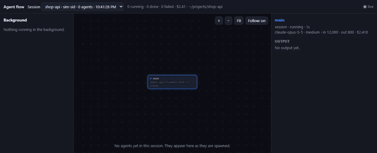

# Flightdeck

A live graph of your Claude Code agents, in your browser. See who spawned whom, what each agent is doing right now, its tool calls, the messages between agents, and what each one returned, as it happens.



- **Graph**: every agent is a card, laid out as a tree with at most three children to a column. Cards glide into place as agents come and go. A live agent pulses, the edge to it carries a moving current, and each spawn, message and returned answer sends a glowing pulse along its edge. Finished agents flash, linger for a few seconds, then fade off the graph. Scroll or use + and − to zoom, and drag to pan. Fit (Follow on by default) keeps the graph framed as it grows.
- **Tool calls**: each card shows the agent's latest tool calls as chips: blue while running, green when ok, red when failed.
- **Details**: click an agent for its prompt, model, effort, tokens and cost, tool calls, messages and output.
- **Background tasks**: the left pane lists backgrounded shell commands, Monitors and Workflows, and marks each one finished when its completion notification arrives, or killed by TaskStop.
- **Timeline, Transcript and Files**: a timeline of every agent and tool call, a filterable transcript, and a heatmap of the files read and edited.
- **Context**: the Timeline shows how full the session's context window is, and a small fill bar for each agent: green, amber from 70%, red from 85%. These are local readings; they make no model request.
- **Agents**: every agent in a table, running ones first, coloured by outcome (blue running, green succeeded, red failed or killed), with model, time, tokens, context fill and cost.
- **Every session**: one page serves every session on the machine, and you pick one from the Session list.

## Install

At the prompt of a Claude Code terminal session:

```
/plugin install flightdeck --marketplace scddesign-dev/flightdeck
```

Answer `y` to add the marketplace, then pick a scope. From a shell:

```
claude plugin install flightdeck --marketplace scddesign-dev/flightdeck
```

In the desktop app, where `/plugin` does not run: click + next to the prompt box, then Plugins, Add marketplace with `scddesign-dev/flightdeck`, then Add plugin.

**Requires Node.js 18 or later on your PATH.** The page is served by a small Node server with no dependencies.

## Updating

Claude Code does not update plugins from this marketplace on its own until you turn that on: run `/plugin`, open the Marketplaces tab, select `flightdeck` and turn on auto-update. To update now instead:

```
claude plugin update flightdeck@flightdeck
```

Then run `/reload-plugins`, or start a new session.

## Use

An interactive session (terminal, desktop app or editor) opens the view on its first turn, once, unless a Flightdeck page is already open. Close the page and it stays closed until you run:

```
/flightdeck
```

`claude -p` runs, SDK runs and hosted sessions never open a browser.

## How it works

- The plugin's hooks record agents, tool calls, messages and background tasks, and write each session's snapshot to `live/<session id>.json` in the plugin's data folder, at most once every 300 ms.
- `server/flightdeck-server.js` serves the page on http://127.0.0.1:4123/ and pushes each snapshot to it over server-sent events. It starts detached the first time it is needed, serves every session, and exits after an hour with no page open.
- Everything stays on your machine: the server listens on 127.0.0.1 only. Snapshots hold your prompts, tool arguments and agent outputs. They are deleted after a week untouched.

Run the server by hand: `node server/flightdeck-server.js 4123 <snapshot folder>`.

## What it runs, and where your data goes

- **Programs it starts**: the plugin's own `node server/flightdeck-server.js`, started detached. On Windows that is `powershell.exe Start-Process`; on macOS and Linux it is `sh -c 'nohup node …'`. To open the page in your default browser it runs `rundll32.exe url.dll,FileProtocolHandler <url>` on Windows and WSL, `open <url>` on macOS, or `xdg-open <url>` on Linux. It installs nothing, downloads nothing and runs no package launcher.
- **What it reads**: your session's agents, prompts, tool calls with their arguments, messages between agents, agent outputs, model names and token and cost figures, as Claude Code reports them to the plugin's hooks.
- **Where that goes**: into JSON files in the plugin's data folder on your machine, and to the page in your browser through the local server. That server listens on 127.0.0.1 only. Nothing is sent to any other machine or service.
- **How long it is kept**: the server deletes a session's snapshot a week after it last changed. Uninstalling the plugin leaves its data folder until Claude Code removes it.
- **Settings**: it changes no Claude Code settings or permissions.

## Limits

- Port 4123 is fixed.
- A background task started by a subagent reports to that agent, not to the session. Such a task shows as "ended" once its agent ends, with no outcome.
- Per-agent cost is the session total's change between model requests. Two agents finishing at the same instant can swap a few cents; the total is exact.

## License

MIT
